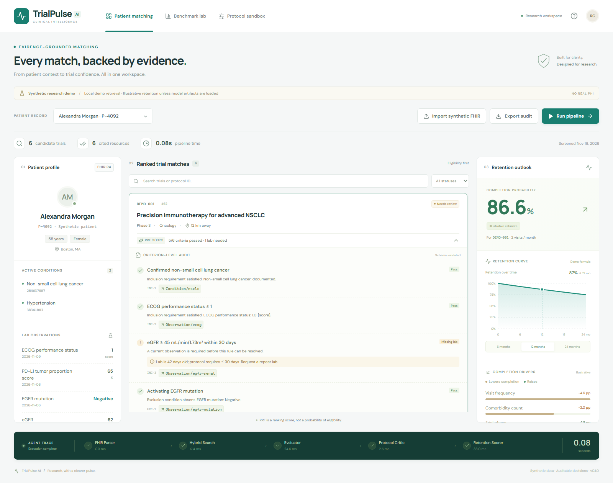
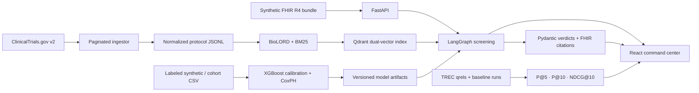
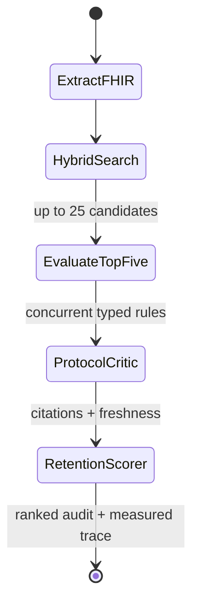

# TrialPulse AI

### Every match, backed by evidence.

A clinical trial screening **research starter** with a three-pane React dashboard, evidence-grounded LangGraph audits, hybrid biomedical retrieval, and retention analytics.

**React + TypeScript · FastAPI · FHIR R4 · Qdrant · BioLORD · LangGraph · Pydantic v2 · XGBoost · Lifelines · SHAP**

[](https://github.com/akcodes-py/-TrialPulse-/actions/workflows/ci.yml)

## Tech stack

| Layer | Technologies | Purpose |
|---|---|---|
| Dashboard | React, TypeScript, Vite | Patient inspection, evidence audits, charts, and protocol simulation |
| API | FastAPI, Pydantic v2, Uvicorn | Validated requests and responses, streaming execution traces |
| Orchestration | LangGraph | Five-stage evidence-grounded screening workflow |
| Retrieval | BioLORD, FastEmbed BM25, Qdrant, RRF | Optional dense/sparse biomedical search |
| Predictive ML | XGBoost, scikit-learn, Lifelines, SHAP | Calibrated completion prediction, survival curves, feature explanations |
| Data and evaluation | FHIR R4, ClinicalTrials.gov v2, Synthea, ir_datasets | Synthetic patient records, public protocols, TREC-compatible evaluation |
| Deployment | Docker Compose, Nginx, GitHub Actions | Containerization, reverse proxy, automated verification |

## Clone the repository

```sh
git clone https://github.com/akcodes-py/-TrialPulse-.git
cd -- -TrialPulse-
```

Then follow the Docker or local-development setup below. Defaults run without credentials; optional ML and retrieval extras are installed separately.

[Engineering manual](manual.md) · [Product requirements](PRD.md) · [Implementation decisions](decision.md) · [Data contracts](docs/data-contracts.md) · [Demo walkthrough](docs/demo.md)

> **Start here if you are reviewing the system:** [`manual.md`](manual.md) explains the objective, the technologies and datasets used, what was implemented and why, and the advantages and limits of the design.



## What you can run

- **Patient matching:** three synthetic patients, six authored protocols, editable patient selection, trial search/status filters, clickable FHIR evidence, and audit JSON export.
- **Agentic audit:** a real LangGraph workflow with typed rule evaluation, exclusion checks, lab freshness checks, and streamed node timings.
- **Retention outlook:** labeled illustrative analytics by default; calibrated XGBoost, CoxPH curves, and SHAP when trained artifacts are loaded.
- **Benchmark lab:** interactive comparison of measured fixture metrics; reads real evaluation reports when supplied.
- **Protocol sandbox:** age/eGFR sliders and a reproducible 240-profile synthetic cohort.
- **Research integrations:** live ClinicalTrials.gov v2 ingestion, BioLORD/BM25 Qdrant indexing, optional structured LLM decomposition, model training, and TREC evaluation CLI.
- **Dataset loaders:** Synthea FHIR zip extraction/discovery, `ir_datasets` TREC export, and an AACT study-outcome normalizer with a hard patient-level labeling warning.

Default records are authored synthetic FHIR examples, not actual Synthea exports. Default protocols use `DEMO-*` IDs rather than real NCT identifiers. Demo retrieval is BM25 plus deterministic lexical hash vectors; it does not load BioLORD. Retention formulas and fixture rankings do not establish clinical performance.

## Quick start: Docker

Requires Docker Desktop/Engine with Compose and an active daemon.

```sh
docker compose up --build
```

Open **http://localhost:3000**. The dashboard starts a synthetic screening automatically.

| Service | URL |
|---|---|
| Dashboard | http://localhost:3000 |
| FastAPI docs | http://localhost:8000/docs |
| Health | http://localhost:8000/api/health |
| Qdrant dashboard | http://localhost:6333/dashboard |

No API key, training step, or model download is required for the demo. `docker compose down` stops services; the named Qdrant volume and local artifacts persist.

## Local development

Use **Python 3.12** (recommended for the ML stack) and **Node.js 22+**. Run Python commands from the repository root.

### Windows / PowerShell

```powershell
py -3.12 -m venv .venv
.\.venv\Scripts\python.exe -m pip install -e ".[dev]"
.\.venv\Scripts\python.exe -m uvicorn backend.app.main:app --reload --host 127.0.0.1 --port 8000
```

In a second terminal:

```powershell
cd frontend
npm ci
npm run dev
```

If the Python launcher does not register 3.12, use the full path to your Python 3.12 executable. Activation is optional; the explicit `.venv` commands work without changing PowerShell's execution policy.

### macOS / Linux

```sh
python3.12 -m venv .venv
source .venv/bin/activate
python -m pip install -e '.[dev]'
python -m uvicorn backend.app.main:app --reload --host 127.0.0.1 --port 8000
```

In a second terminal, run `npm ci` and `npm run dev` inside `frontend/`. Open **http://localhost:5173**. Vite proxies `/api` to port 8000.

## Architecture





**Verdicts:** `PASS`, `FAIL`, `MISSING_LAB`, `UNKNOWN`. Missing medication history is unknown; a negative documented exclusion finding passes the exclusion criterion. Any failed criterion dominates unresolved criteria. See [`decision.md`](decision.md) for the reasoning and supported clinical scope.

## Enable biomedical retrieval

Install the retrieval extras in the active Python environment:

```sh
python -m pip install -e '.[retrieval]'
docker compose up -d qdrant
python -m backend.scripts.fetch_trials --condition "non-small cell lung cancer" --limit 250
python -m backend.scripts.index_trials --input data/local/trials.jsonl
```

Indexing downloads `FremyCompany/BioLORD-2023` and `Qdrant/bm25` on first use. Model loading and embedding require additional memory/time. Each indexed point carries both named vectors and a normalized trial payload. Indexing requires a **new collection** to avoid accidentally mixing model versions or corpora; set `TRIALPULSE_COLLECTION` to a new name for a new index.

Copy `.env.example` to `.env` and change:

```dotenv
TRIALPULSE_RETRIEVAL=qdrant
TRIALPULSE_QDRANT_URL=http://localhost:6333
TRIALPULSE_COLLECTION=trialpulse
```

Restart the backend. The live mode does not silently fall back to demo results if Qdrant or model loading fails. Raw free-text medical rules remain `UNKNOWN` until supported or curated; current ingestion does not magically solve arbitrary staging or washout language.

## Load the recommended open datasets

### Synthea FHIR R4

Download the public synthetic sample archive into the ignored `data/local/fhir/` directory:

```sh
python -m backend.scripts.download_synthea
```

The loader follows redirects, optionally verifies `--sha256`, safely extracts archive paths, limits discovered JSON bundles to 5 MB, and never uploads the records. Restart the backend or refresh the browser; locally discovered `Patient/{id}` profiles are added to the patient selector. The current parser is targeted FHIR normalization, not a full FHIR validator.

### TREC Clinical Trials

The benchmark track is available through `ir_datasets`. The exporter currently supports the Clinical Trials 2021 and 2022 tracks documented by `ir_datasets`:

```sh
python -m pip install -e '.[benchmark]'
python -m backend.scripts.export_trec --dataset 2021 --output data/local/trec/2021
```

This writes `docs.jsonl`, `queries.tsv`, and standard `qrels.txt`. Use the qrels with your generated run files through `evaluation.eval_trec`. The exporter uses the `ir_datasets` snapshot metadata; it does not claim that a current ClinicalTrials.gov corpus is equivalent to the historical benchmark snapshot. TREC Clinical Trials relevance semantics are track-specific: the 2021 track uses 0 = not relevant, 1 = excluded, 2 = eligible, while older Precision Medicine tracks use different wording.

### AACT study outcomes

AACT is useful for study-level protocol/outcome analytics, but `COMPLETED`, `TERMINATED`, or `WITHDRAWN` are **whole-study outcomes**, not individual participant dropout labels. Do not join them to Synthea patients and call the result observed retention. The repository provides a transparent normalizer only:

```sh
python -m backend.scripts.import_aact \
  --input path/to/aact_studies.csv \
  --output data/local/aact/study_outcomes.csv
```

For XGBoost/CoxPH participant retention, use a permissioned patient-level trial dataset such as a properly licensed Project Data Sphere cohort, or an approved MIMIC-IV cohort for an explicitly defined proxy endpoint. MIMIC-IV is ICU/hospital data, not clinical-trial retention, and requires PhysioNet credentialing, training, and a data-use agreement. Project Data Sphere also has access/registration terms. Neither dataset is downloaded automatically by this repository.

For a fully containerized research image, set `PYTHON_EXTRAS=retrieval,ml` in `.env`, rebuild, then run the same CLI modules with `docker compose exec backend python -m ...`. The backend container uses `http://qdrant:6333` automatically. Fetch and index while the dashboard is still in demo mode, then enable live retrieval.

### Optional structured LLM decomposition

Configure an OpenAI-compatible **base URL including `/v1`**, API key, and model name in `.env`:

```dotenv
TRIALPULSE_LLM_URL=https://your-provider.example/v1
TRIALPULSE_LLM_API_KEY=your-key
TRIALPULSE_LLM_MODEL=your-structured-output-model
```

Run ingestion with `--llm`. This sends **public protocol text**, not patient bundles, to the provider. Schema/grounding validation gets three attempts. The original protocol remains a review criterion after extraction, so an omitted clause cannot silently make a patient eligible. Providers must support the supplied JSON Schema response format. HTTP/provider failures surface to the CLI.

## Train retention models

```sh
python -m pip install -e '.[ml]'
python -m backend.scripts.train_retention --synthetic
```

This creates `artifacts/retention.joblib` and `artifacts/training_metrics.json`. Subsequent screening requests load the artifact and display **Synthetic-trained model**, actual CoxPH curves, and base-model SHAP log-odds. No server restart is required for a changed artifact.

For a labeled cohort:

```sh
python -m backend.scripts.train_retention --csv data/local/cohort.csv
```

CSV columns:

```text
age,comorbidity_count,visits_per_month,phase,distance_km,completed,duration_months,event_observed
```

- One independent participant per row; `phase` is numeric 1–4.
- `completed=1` denotes known protocol completion; `event_observed=1` denotes dropout.
- Duration is months; completion is censored for the dropout survival endpoint.
- Early-censored records with unknown completion must not be assigned a negative completion label.
- Training separates base fit, calibration, and test data; reports five-fold base AUC, held-out calibrated AUC, Brier score, and survival concordance.
- ClinicalTrials.gov does not supply measured patient distance and protocol visit frequency here. Live matches with missing inputs return an unavailable score.

The generated synthetic cohort is for exercising training and scoring, not validating predictive benefit. See [data contracts](docs/data-contracts.md) for interpretation and limitations.

## Evaluate retrieval

The evaluator accepts standard qrels plus any number of TREC run files. Example (single line, works in PowerShell too):

```sh
python -m evaluation.eval_trec --qrels evaluation/fixtures/qrels.txt --run "BM25=evaluation/fixtures/bm25.run" --run "Dense=evaluation/fixtures/dense.run" --run "Hybrid + audit=evaluation/fixtures/hybrid.run" --dataset "Synthetic fixture · 3 topics (not TREC)"
```

It writes `artifacts/evaluation_results.json`; the benchmark view reads this file on its next mount. Without the file, it computes the included synthetic fixture metrics on demand.

For real TREC evaluation, substitute a matching year/split's qrels and run paths, and set `--dataset` accurately. All three runs must use the **same frozen corpus and topic set**. The evaluator does not download licensed corpora or fabricate baseline results. TREC text vignettes need a provenance-preserving structured annotation step before the FHIR evidence evaluator can audit them.

Metric conventions: precision relevance grade ≥ 2 by default (`--relevant-grade`), linear graded NDCG, fixed K denominators, nonrelevant unjudged documents, score-descending ranking, duplicate rejection, and zero scores for missing topics.

## API

| Method | Endpoint | Purpose |
|---|---|---|
| GET | `/api/health` | Dependency-free liveness, API version, and environment |
| GET | `/api/ready` | Readiness: artifact directory and, in `qdrant` mode, vector-store reachability |
| GET | `/api/patients` | Synthetic patient profiles |
| GET | `/api/patients/{id}/fhir` | Synthetic source bundle |
| POST | `/api/pipeline` | JSON screening response |
| POST | `/api/pipeline/stream` | SSE `step`, `result`, `error` events |
| POST | `/api/pipeline/fhir` | Screen an imported synthetic bundle without persisting it |
| GET | `/api/benchmarks` | Current report or labeled fixture results |
| POST | `/api/sandbox` | Patient-pool simulation from age/eGFR thresholds |

Pipeline request: `{"patient_id":"P-4092","top_k":25,"audit_k":5}`. Import request: `{"bundle":{...},"synthetic_acknowledged":true}`. Interactive schemas live at `/docs` on the API service.

## Verification

Backend, from the root in the Python environment:

```sh
python -m pytest -q
python -m ruff check .
docker compose config --quiet
```

Frontend, from `frontend/`:

```sh
npm run build
npx playwright install chromium
npm run test:e2e
```

Playwright starts the backend and Vite automatically (or reuses local instances), checks desktop/mobile interactions, patient switching, evidence dialogs, filtering, benchmark selection, sandbox updates, and horizontal overflow. GitHub Actions contains backend, build, and browser jobs.

With both local servers running, `npm run capture` in `frontend/` regenerates the [dashboard](docs/dashboard.png), [benchmark](docs/benchmark.png), and [sandbox](docs/sandbox.png) images. See [verification notes](docs/verification.md) for the checks run during implementation.

## Repository map

```text
trialpulse-ai/
├── decision.md                  # Implementation decision log
├── PRD.md                     # Product requirements and acceptance scope
├── README.md
├── backend/
│   ├── app/                   # API, FHIR, rules, graph, retrieval, retention
│   └── scripts/               # Live ingestion, Qdrant indexing, model training
├── frontend/
│   ├── src/                   # React dashboard and interactive charts
│   └── tests/                 # Playwright desktop/mobile flows
├── evaluation/                # Qrels/run evaluator and synthetic fixtures
├── tests/                     # Clinical edge cases, API, metrics
├── docs/                      # Data contracts and demo walkthrough
├── artifacts/                 # Local model/evaluation outputs (gitignored)
├── data/local/                # Downloaded corpora (gitignored)
├── docker-compose.yml
└── .github/workflows/ci.yml
```

## Current boundaries

This is a research implementation of the requested architecture. It has no validated real-patient retention model, no measured TREC gains, and no established 50,000-trial latency result. FHIR parsing and typed rule coverage are deliberately explicit; arbitrary medical reasoning, terminology translation, temporal washouts, and image models need additional work. The UI’s “criteria met” status means the executable screening rules passed, not that enrollment has been approved.

Local Compose ports bind to `127.0.0.1`; this starter has no multi-user authentication. Patient bundles remain request/browser memory unless a user deliberately exports an audit. Default logging does not include request bodies, and optional LLM decomposition receives only protocol text. External font requests are cosmetic; system-font fallbacks work offline.

### Before public deployment

- Terminate HTTPS at a trusted proxy and add authentication/authorization before exposing patient routes.
- Configure allowed hosts, keep Qdrant private, and inject credentials through a secret manager.
- Use gateway-based rate limiting for multiple replicas; the included limiter is per process.
- Validate model artifacts and dependency versions, and measure performance against your deployment's workload.
- Complete dataset-permission, security, and clinical-validation review before using non-synthetic records.

The included controls improve deployment safety; they are not evidence of HIPAA compliance or clinical readiness. Container builds are configured in CI; a successful local Compose configuration check alone does not verify container runtime behavior.

## References

- [ClinicalTrials.gov API](https://clinicaltrials.gov/data-api/api)
- [HL7 FHIR R4](https://hl7.org/fhir/R4/)
- [Synthea](https://github.com/synthetichealth/synthea)
- [BioLORD model](https://huggingface.co/FremyCompany/BioLORD-2023)
- [Qdrant hybrid queries](https://qdrant.tech/documentation/concepts/hybrid-queries/)
- [TREC Clinical Trials Track](https://www.trec-cds.org/)

The repositories mentioned in the original brief are architectural inspiration, not bundled dependencies or copied implementation sources.
